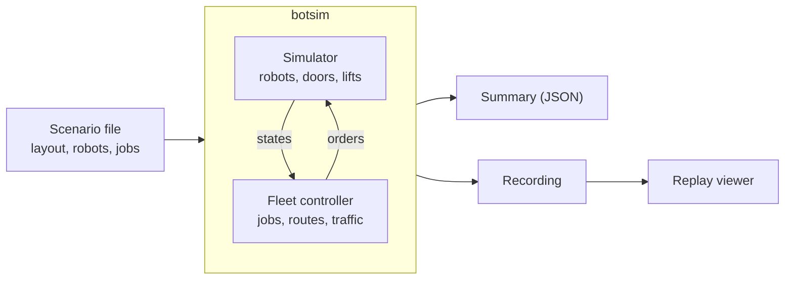

# botsim

Simulator for mixed robot fleets with dispatching and traffic control (VDA 5050)

It runs headless: robots execute orders on a LIF layout, and the controller is
measured on throughput, waiting, deadlocks and collisions. Work in progress.

[](https://www.youtube.com/watch?v=wbVRCgwhrG8)

A longer run on a more complex warehouse: [video, 6:40](https://www.youtube.com/watch?v=WVp4MgZwQKg)

## Workspace

```text
botsim/
├── crates/
│   ├── model/         layout graph, robot types, path and safety geometry
│   ├── link/          compact messages: fleet server, robots, doors, lifts
│   ├── vda/           translation between link and VDA 5050 messages
│   ├── sim/           simulator: world, robots, orders, collisions, jobs
│   ├── scenario/      scenario file (TOML): loading, building the world
│   ├── router/        route search on the layout graph
│   ├── dispatcher/    jobs to robots, charging and parking trips
│   ├── server/        fleet server: control loop, slot for the traffic rules,
│   │                  traffic adapter
│   ├── baseline/      first come, first served traffic rules, kept as reference
│   ├── traffic/       passing order at shared spots (--policy traffic)
│   ├── space/         swept robot outlines and the conflict map
│   ├── runner/        command line, JSON summary; connects the server and the
│   │                  simulator (package botsim)
│   ├── check/         static layout checker (checks: see its README)
│   ├── record/        recording of a run (JSON Lines)
│   ├── export/        PNG frames for videos, layout generators
│   └── viewer/        replay window, check overlay, usage heat map
└── scenarios/         example scenarios and layouts
```

Each crate's package is `botsim-<folder>`, except the runner, which is `botsim`.

Details: [run](crates/runner/README.md), [check](crates/check/README.md),
[conflict map](crates/space/README.md), [viewer](crates/viewer/README.md),
[video](crates/export/README.md).

## Quick start

```sh
# run a scenario, print a JSON summary
cargo run --release -p botsim -- scenarios/ring_jobs.toml

# check a layout without simulating
cargo run --release -p botsim-check -- scenarios/warehouse4.toml

# record a run and watch it
cargo run --release -p botsim -- --record run.jsonl scenarios/warehouse.toml
cargo run --release -p botsim-viewer -- run.jsonl
```

## How a run works



## Licence

MIT
