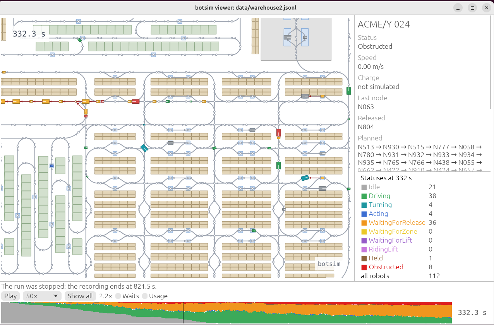

# botsim-viewer

Replays a botsim recording in a window: where the robots are, what they do (colour
by status), who blocks whom, where a deadlock forms. The picture is the same one
`botsim-export` draws for a video (same colours, same drawing), made for the size
of the window.



Run the commands from the root of the repository (the directory with the
workspace `Cargo.toml`, `scenarios/` and `data/`; `data/` is not in git):

```sh
cd /path/to/botsim
# record a run (and its static geometry), then open it
cargo run --release -p botsim -- --record data/warehouse.jsonl \
    --geometry scenarios/warehouse.geometry.json scenarios/warehouse.toml
cargo run --release -p botsim-viewer -- data/warehouse.jsonl
```

Use `--release`: a debug build is too slow to load a large recording.

Controls:

| | |
|---|---|
| **Space**, or the Play / Pause button | play / pause |
| **Left** / **Right** | 1 s back / forward (with **Shift**: 10 s) |
| **Home** / **End**, or **Ctrl + Left** / **Ctrl + Right** | jump to the start / the end |
| **[** / **]** | slower / faster |
| **W**, or the **Waits** box | the "waiting caused by others" overlay: instead of the red blocking arrows, an arrow from each waiting robot to its blocker coloured by reason (the legend is beside the box), and a ring in that colour round a robot whose blocker is unknown; "no wait data in this recording" for a recording without it |
| **click a robot** | its details appear in the side panel; click empty floor to deselect |
| the slider | scrub through the run |
| the speed menu | simulated seconds per real second (0.5× to 100×) |

At the end it stops; Play then starts again from the beginning.

The side panel (right) shows, for the selected robot and the moment on the
timeline: its id, status, speed, order, last node, the nodes ahead that it may
drive (released) and those not released yet (planned), the robots it waits for
and the robots that wait for it. It follows the robot as time moves.

The time line at the bottom is a stacked histogram of the robot statuses over
time (the colours of the table at the right) and is also the scrubber: click or
drag on it to jump. The wheel zooms, dragging moves the picture, a double click
shows all.

## Layout check

```sh
cargo run --release -p botsim-viewer -- --check scenarios/warehouse4.toml data/warehouse4.jsonl
```

With `--check <scenario.toml>` the [layout checker](../check/README.md) runs in
the background. Each finding is drawn as a ring (red error, orange warning, blue
info; click one for the text), with one box for each severity, and the pairs of
edges that overlap without a common node as lines.

## Road usage

The **Usage** box shows only a heat map of how long each road was reserved and
where robots waited, for a window of time ("from" and "to"). With
`<scenario>.groups.json` next to the scenario (the generated warehouse scenarios
have one) it also lists the use by group of roads. A run that freezes says most
about its first minutes, so use the window.

The same as text (busiest edges, waiting, groups of roads):

```sh
cargo run --release -p botsim-viewer --example usage_report -- data/warehouse4.jsonl --to 600
```

## Drawing

Where robot types follow different curves on an edge, all the curves are drawn
dimmed; with a robot selected, the curve of its type is drawn strong.

The text in the picture (clock, name) needs a font on the system; without one the
picture is drawn without text.

On Linux the window uses Wayland or X11, whichever the session has.
